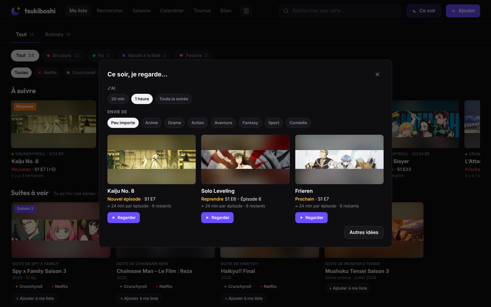
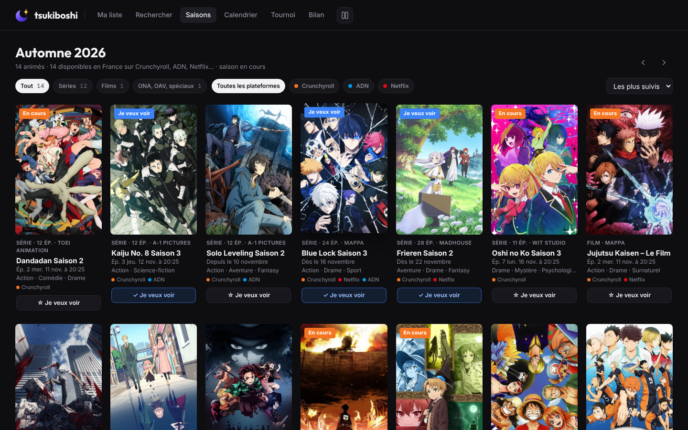
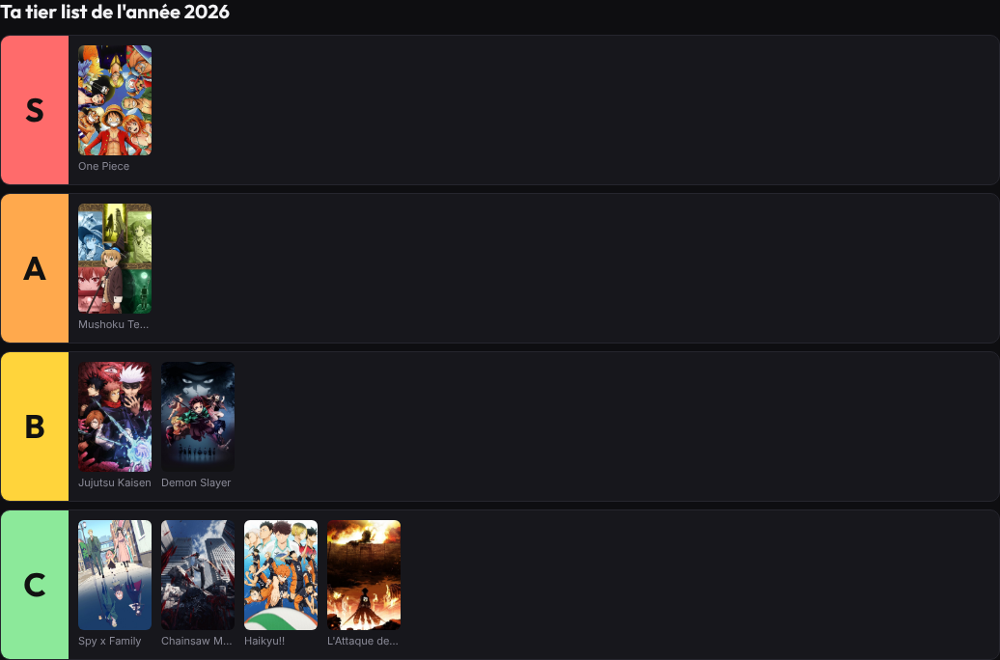
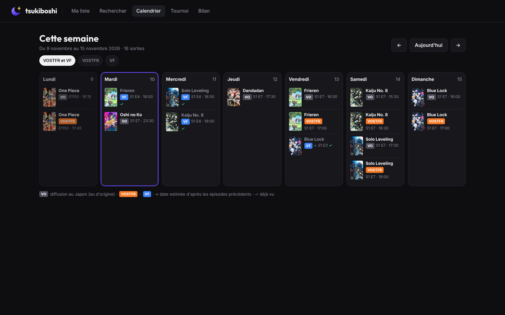
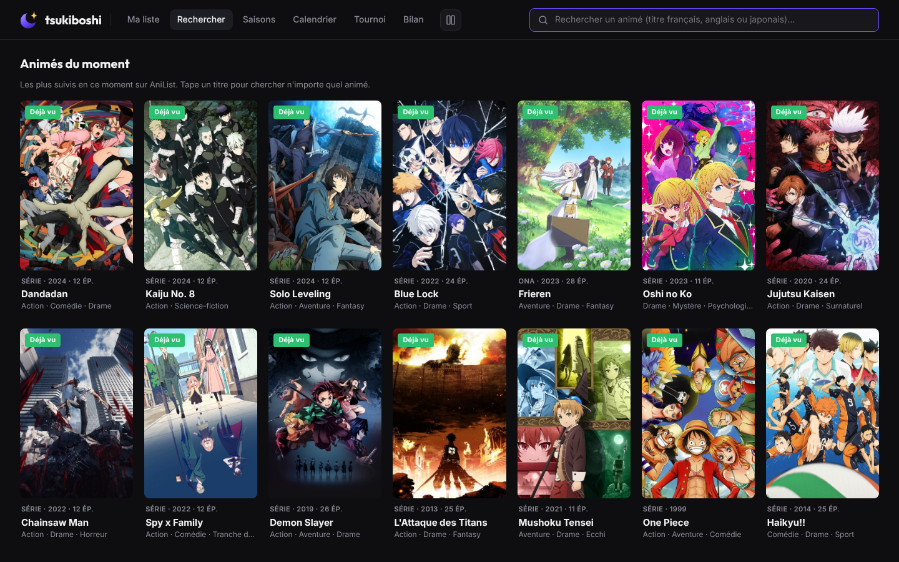
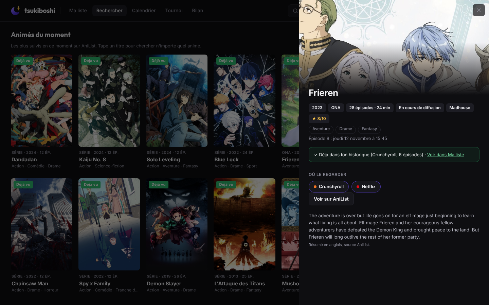
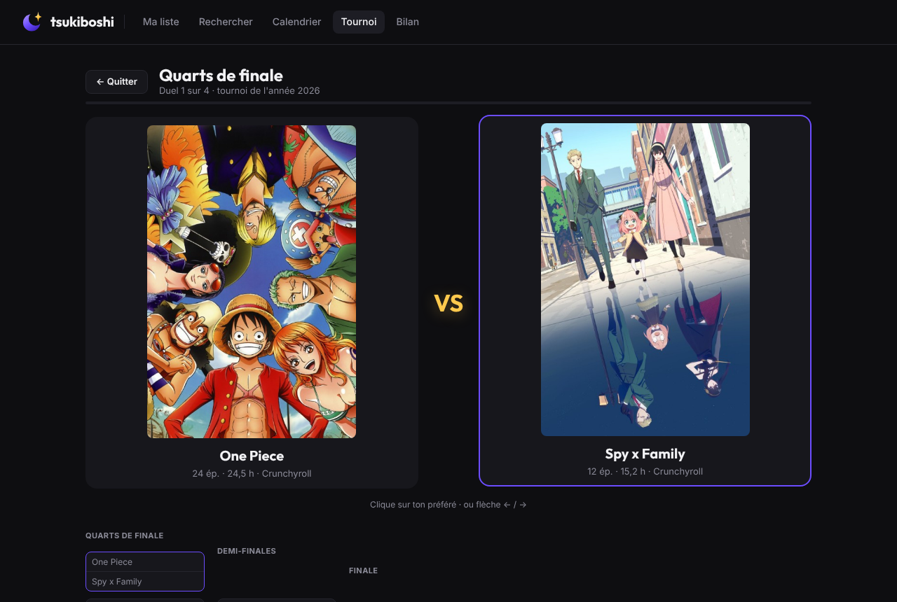
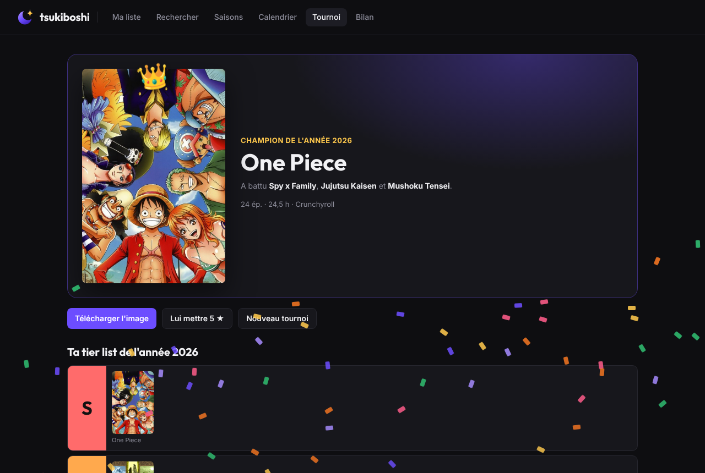

# tsukiboshi 月星

**Ton journal de visionnage anime, séries et films, tenu à jour tout seul.**
Extension pour **Chrome, Edge, Opera, Brave et Vivaldi** qui récupère tout ton historique Crunchyroll, ADN, Netflix, Disney+ et Prime Video depuis la création de ton compte, le range par série dans un fichier Excel et dans une belle page « Ma liste » façon Plex, puis continue discrètement après chaque épisode.

> Captures réalisées avec des données de démonstration. Les affiches appartiennent à leurs studios respectifs et servent uniquement d'illustration ([détails](docs/CREDITS.md)). Chez toi, l'extension trouve automatiquement les affiches de tes propres séries et films.

## Ce qu'elle fait

- **Import complet** de l'historique de chaque plateforme, en un clic, même avec des milliers d'épisodes.
- **Suivi automatique** : chaque épisode regardé plus d'une minute est ajouté (date, heure, temps regardé), et le bouton **Synchro** récupère aussi ce que tu regardes sur la TV ou le téléphone (ou toutes les 6 h si tu actives la synchro automatique : rien ne se lance sans ton accord).
- **Fichier Excel** toujours à jour, regroupé par série, avec statut, progression, genres, ta note et ton avis.
- **Ma liste** : affiches trouvées automatiquement, sous-onglets *Animés / Séries / Films*, statuts *En cours / Vu / Ajouté à la liste*, épisode où tu en es, filtres par plateforme, genre et époque, tri par ta note, **sélection multiple** pour changer le statut de plusieurs titres d'un coup.
- **Ce soir** : tu dis combien de temps tu as et ce dont tu as envie, il te propose 3 choses à lancer en un clic.
- **Calendrier des sorties** : date et heure de chaque épisode à venir de tes séries en cours, en VO, VOSTFR et VF (dates estimées « ≈ » quand elles ne sont pas encore annoncées), avec le choix « Je regarde en VOSTFR / VF » ; une série pas reconnue se relie en un clic.
- **Saisons** : tous les animés de la saison (hiver, printemps, été, automne), avec date de sortie et plateformes, et un bouton **Je veux voir** qui les ajoute à ta liste et à ton calendrier.
- **Rechercher un animé** : n'importe quel animé, ses saisons, films et OAV, et où le regarder légalement (Crunchyroll, ADN, Netflix…), ou les animés du moment.
- **Suites à voir** : la nouvelle saison, le film ou l'OAV des animés que tu as finis, avec où les regarder ; et quand l'animé n'a plus de suite, **le manga** pour connaître la fin (liens de lecture officiels).
- **À suivre** : reprendre un épisode en cours ou lancer le suivant en un clic (seulement ce qui est à lancer, pas une liste sans fin).
- **Marquer comme vu** : dans la fiche d'un titre, ou avec le bouton « Marquer comme vu » de Crunchyroll.
- **Alertes de nouveaux épisodes** pour tes simulcasts Crunchyroll, et dès qu'un épisode sort en VF.
- **Tournoi** : tes titres de la semaine, du mois ou de l'année s'affrontent en duels jusqu'au champion, avec ta **tier list** (S, A, B, C, D) et une image à partager ; le **méga-tournoi** fait s'affronter les champions de chaque mois.
- **Bilan** : heures regardées, calendrier de tes soirées, top 10, genres préférés, records.
- **Notes, favoris et avis** sur chaque titre, et un statut *Abandonné* pour ce que tu as laissé tomber.
- **Sauvegarde / restauration** pour changer de PC sans rien perdre.
- **Affichage vertical ou horizontal** : affiches en hauteur et jours en colonnes, ou images larges et jours en lignes, pour toute l'app.
- **Mise à jour signalée** : un bandeau prévient quand une nouvelle version est disponible ici.

## En images

| Fiche d'un titre | Ce soir |
|---|---|
|  |  |

| Saisons : « Je veux voir » | Tier list du tournoi |
|---|---|
|  |  |

| Calendrier des sorties (VO, VOSTFR, VF) | Rechercher un animé |
|---|---|
|  |  |

| Où regarder un animé | Tournoi |
|---|---|
|  |  |

| Champion du tournoi | Bilan | Popup |
|---|---|---|
|  |  |  |

## Installation

Fonctionne sur tous les navigateurs basés sur Chromium : **Google Chrome, Microsoft Edge, Opera (et Opera GX), Brave et Vivaldi**.
Firefox et Safari ne sont pas encore pris en charge.

**1. Télécharger l'extension (identique pour tous les navigateurs)**
- Va dans [**Releases**](https://github.com/NateagXiorcled/tsukiboshi/releases/latest) et télécharge le fichier `tsukiboshi-x.y.z.zip` (le plus léger),
  ou bouton **Code → Download ZIP** sur cette page.
- Décompresse-le dans un dossier que tu garderas (par exemple `Documents/tsukiboshi`) : le navigateur lit l'extension depuis ce dossier, il ne faut pas le supprimer.

**2. L'ajouter à ton navigateur**

| Navigateur | Adresse à taper | Puis |
|---|---|---|
| **Chrome** | `chrome://extensions` | Active **Mode développeur** (en haut à droite) → **Charger l'extension non empaquetée** |
| **Edge** | `edge://extensions` | Active **Mode développeur** (dans le menu de gauche) → **Charger l'extension décompressée** |
| **Opera / Opera GX** | `opera://extensions` | Active **Mode développeur** (en haut à droite) → **Charger l'extension non empaquetée** |
| **Brave** | `brave://extensions` | Active **Mode développeur** (en haut à droite) → **Charger l'extension non empaquetée** |
| **Vivaldi** | `vivaldi://extensions` | Active **Mode développeur** (en haut à droite) → **Charger l'extension non empaquetée** |

Choisis le dossier décompressé (celui qui contient `manifest.json`). L'icône 月 apparaît dans la barre d'extensions : épingle-la pour l'avoir toujours sous la main
(icône puzzle 🧩 → punaise ; sur Opera, icône cube dans la barre latérale ou en haut à droite).

**3. Enregistrement automatique du fichier Excel**

Pour que le fichier Excel se mette à jour sans te poser de question à chaque fois, ouvre les réglages des téléchargements
(`chrome://settings/downloads`, `edge://settings/downloads`, `opera://settings/downloads`, `brave://settings/downloads` ou `vivaldi://settings/downloads`)
et **désactive l'option qui demande où enregistrer chaque fichier** (son nom varie un peu selon le navigateur : « Toujours demander où enregistrer les fichiers », « Demander où enregistrer chaque fichier avant de télécharger »…).

**Mettre à jour** : télécharge le nouveau zip, remplace le contenu du dossier par le nouveau, puis clique sur ↻ (Recharger) sous tsukiboshi dans la page des extensions.
Tes données sont gardées. Un bandeau dans l'extension te prévient quand une nouvelle version sort.

> Au démarrage, Edge, Opera ou Brave peuvent afficher « Désactiver les extensions en mode développeur ? » : clique sur **Conserver** (ou ferme le message), c'est normal pour une extension installée à la main.

Ensuite : clique sur l'icône tsukiboshi → **Importer** à côté de chaque plateforme. Le fichier Excel apparaît dans `Téléchargements/Tsukiboshi/`.

Le [guide complet](docs/GUIDE.md) explique chaque fonction en détail.

## Vie privée

- Tout reste **sur ton ordinateur**, dans ton navigateur. Aucun serveur, aucun compte, aucune statistique envoyée.
- L'extension lit l'historique **de ton propre compte**, avec ta propre session, comme si tu le consultais toi-même. Elle ne contourne aucune protection et ne touche pas aux vidéos.
- Pour les affiches, les genres et les dates de sortie, seul le **titre** d'une série (ou la saison consultée) est envoyé à des bases publiques (AniList, TVmaze, IMDb, iTunes, Allociné et, si tu ajoutes ta clé, TMDB).
- Une fois par jour, l'extension regarde sur GitHub si une nouvelle version existe (aucune donnée envoyée).

## Limites

- L'heure exacte n'est connue que pour Netflix et les épisodes suivis en direct ; les autres historiques donnent seulement le jour.
- Les dates VOSTFR et VF viennent du catalogue Crunchyroll : pour les autres plateformes, seule la date VO est affichée.
- Disney+ n'a pas de page d'historique : seuls les épisodes regardés dans ce navigateur sont enregistrés.
- Si une plateforme change son site, l'import correspondant peut cesser de fonctionner jusqu'à une mise à jour.

## Avertissement

Projet personnel et non officiel, sans aucun lien avec Crunchyroll, ADN, Netflix, Disney+ ou Amazon Prime Video. Les noms de ces services sont des marques de leurs propriétaires respectifs. À utiliser pour ton usage personnel, avec ton propre compte, dans le respect des conditions d'utilisation de chaque service.

## Licence

Code sous licence [MIT](LICENSE). Polices Inter et Outfit sous [SIL Open Font License 1.1](fonts/OFL.txt). Affiches des captures : © leurs ayants droit, voir [docs/CREDITS.md](docs/CREDITS.md).

---

### English

*tsukiboshi* is a browser extension (Chrome, Edge, Opera, Brave, Vivaldi) that imports your full watch history from Crunchyroll, ADN, Netflix, Disney+ and Prime Video, keeps an Excel log grouped by series, and shows a Plex-like "My list" page with posters, progress, a release calendar (original, subbed and dubbed dates), anime search with where to watch, new-episode alerts, a "tournament" game and yearly stats. Install: download the zip from Releases, unzip it, open the extensions page (`chrome://extensions`, `edge://extensions`, `opera://extensions`…), turn on Developer mode and choose "Load unpacked". Everything stays local in your browser. The interface is in French. Unofficial personal project, not affiliated with any of these services. MIT licensed.
