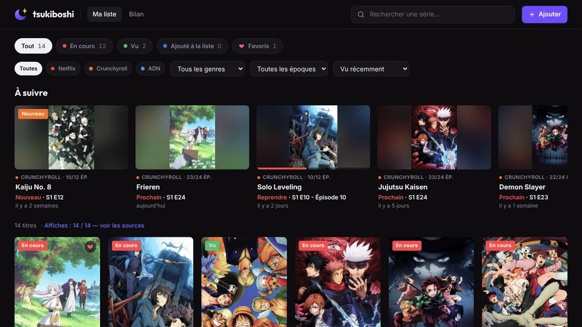
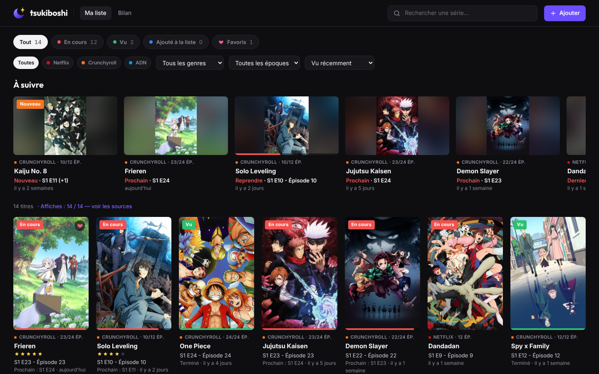
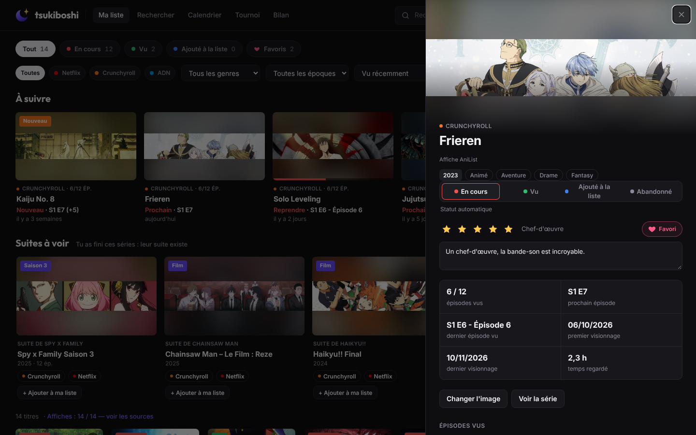
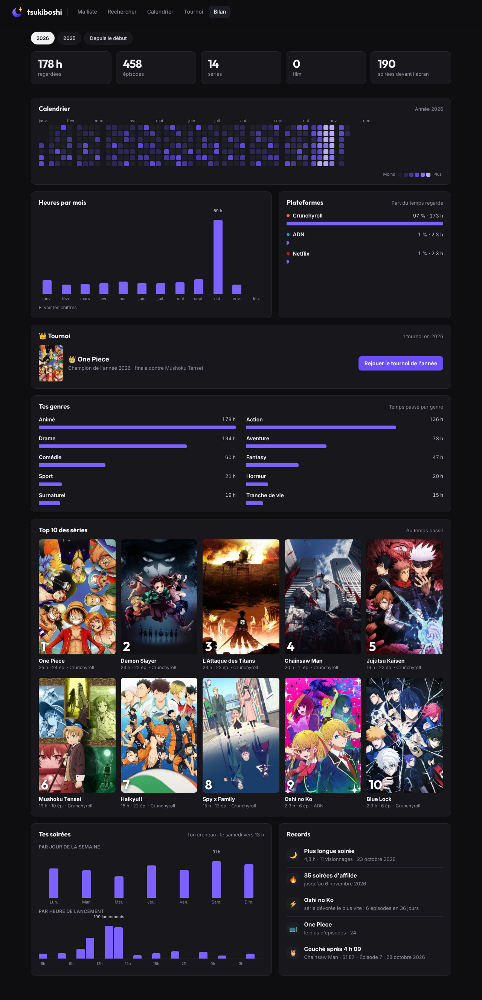
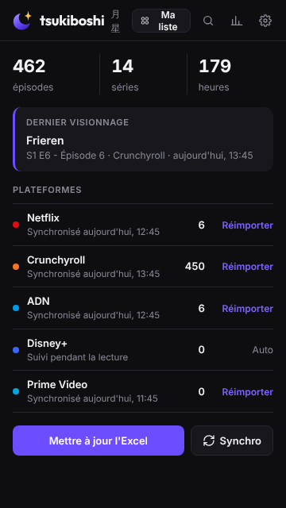

# tsukiboshi 月星

**Ton journal de visionnage anime, séries et films, tenu à jour tout seul.**
Extension Chrome qui récupère tout ton historique Crunchyroll, ADN, Netflix, Disney+ et Prime Video depuis la création de ton compte, le range par série dans un fichier Excel et dans une belle page « Ma liste » façon Plex, puis continue discrètement après chaque épisode.

> Captures réalisées avec des données de démonstration. Les affiches appartiennent à leurs studios respectifs et servent uniquement d'illustration ([détails](docs/CREDITS.md)). Chez toi, l'extension trouve automatiquement les affiches de tes propres séries et films.

## Ce qu'elle fait

- **Import complet** de l'historique de chaque plateforme, en un clic, même avec des milliers d'épisodes.
- **Suivi automatique** : chaque épisode regardé plus d'une minute est ajouté (date, heure, temps regardé), et une synchro discrète toutes les 6 h récupère aussi ce que tu regardes sur la TV ou le téléphone.
- **Fichier Excel** toujours à jour, regroupé par série, avec statut, progression, genres, ta note et ton avis.
- **Ma liste** : affiches trouvées automatiquement, statuts *En cours / Vu / Ajouté à la liste*, épisode où tu en es, filtres par plateforme, genre et époque.
- **Ce soir** : tu dis combien de temps tu as et ce dont tu as envie, il te propose 3 choses à lancer en un clic.
- **Suites à voir** : la nouvelle saison, le film ou l'OAV des animés que tu as finis, avec où les regarder.
- **À suivre** : reprendre un épisode en cours ou lancer le suivant en un clic.
- **Alertes de nouveaux épisodes** pour tes simulcasts Crunchyroll.
- **Tournoi** : tes titres de la semaine, du mois ou de l'année s'affrontent en duels jusqu'au champion, avec une image à partager.
- **Bilan** : heures regardées, calendrier de tes soirées, top 10, genres préférés, records.
- **Notes, favoris et avis** sur chaque titre.
- **Sauvegarde / restauration** pour changer de PC sans rien perdre.

| Fiche d'un titre | Bilan | Popup |
|---|---|---|
|  |  |  |

## Installation

1. Télécharge le projet : bouton **Code → Download ZIP**, puis décompresse-le.
2. Ouvre `chrome://extensions`, active le **Mode développeur** (en haut à droite).
3. Clique sur **Charger l'extension non empaquetée** et choisis le dossier décompressé.
4. Dans `chrome://settings/downloads`, désactive « Toujours demander où enregistrer les fichiers ».

Ensuite : clique sur l'icône tsukiboshi → **Importer** à côté de chaque plateforme. Le fichier Excel apparaît dans `Téléchargements/Tsukiboshi/`.

Le [guide complet](docs/GUIDE.md) explique chaque fonction en détail.

## Vie privée

- Tout reste **sur ton ordinateur**, dans ton navigateur. Aucun serveur, aucun compte, aucune statistique envoyée.
- L'extension lit l'historique **de ton propre compte**, avec ta propre session, comme si tu le consultais toi-même. Elle ne contourne aucune protection et ne touche pas aux vidéos.
- Pour les affiches et les genres, seul le **titre** d'une série est envoyé à des bases publiques (AniList, TVmaze, IMDb, iTunes, Allociné et, si tu ajoutes ta clé, TMDB).

## Limites

- L'heure exacte n'est connue que pour Netflix et les épisodes suivis en direct ; les autres historiques donnent seulement le jour.
- Disney+ n'a pas de page d'historique : seuls les épisodes regardés dans ce navigateur sont enregistrés.
- Si une plateforme change son site, l'import correspondant peut cesser de fonctionner jusqu'à une mise à jour.

## Avertissement

Projet personnel et non officiel, sans aucun lien avec Crunchyroll, ADN, Netflix, Disney+ ou Amazon Prime Video. Les noms de ces services sont des marques de leurs propriétaires respectifs. À utiliser pour ton usage personnel, avec ton propre compte, dans le respect des conditions d'utilisation de chaque service.

## Licence

Code sous licence [MIT](LICENSE). Polices Inter et Outfit sous [SIL Open Font License 1.1](fonts/OFL.txt). Affiches des captures : © leurs ayants droit, voir [docs/CREDITS.md](docs/CREDITS.md).

---

### English

*tsukiboshi* is a Chrome extension that imports your full watch history from Crunchyroll, ADN, Netflix, Disney+ and Prime Video, keeps an Excel log grouped by series, and shows a Plex-like "My list" page with posters, progress, new-episode alerts and yearly stats. Everything stays local in your browser. The interface is in French. Unofficial personal project, not affiliated with any of these services. MIT licensed.
